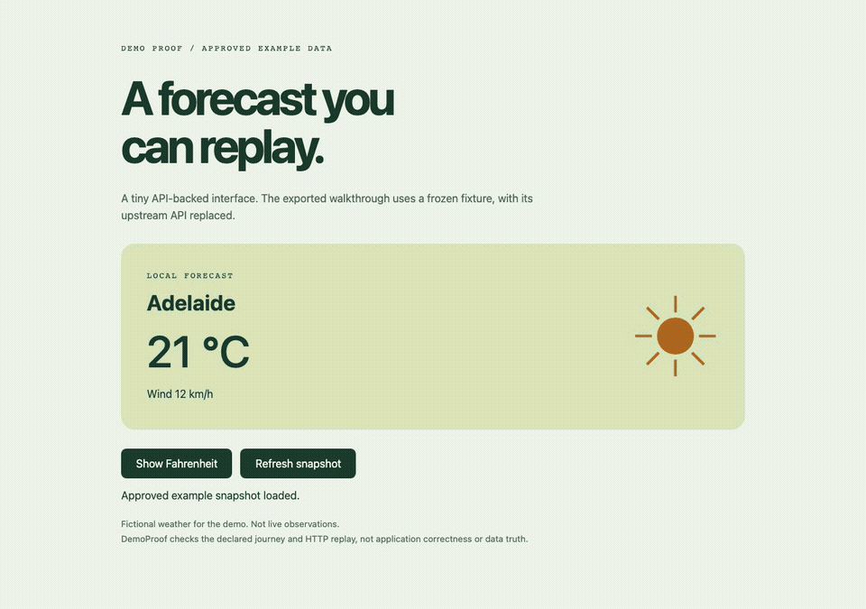

# DemoProof

**An approved demo snapshot, a real browser recording, and evidence you can inspect.**

Experimental local tooling for static web apps with JSON APIs. Capture declared application assets and **explicitly approved example fields**, stop the original server, then replay the journey to produce an MP4, optional GIF, screenshot and checksummed report. It reuses Playwright and ffmpeg; no model, account, cloud upload or paid service.

[Inspect the actual example report](https://rockenzo.github.io/demo-proof/) · [Example bundle](docs/demo/bundle.json)



This is an internal-tested prototype, not externally validated adoption or a general privacy/security certification. All examples use fictional weather data.

## Run from source

Requires Node.js 22+, ffmpeg on PATH, and Playwright's Chromium. The npm package is **not published**.

```bash
git clone https://github.com/RockENZO/demo-proof.git
cd demo-proof
npm ci
npx playwright install chromium
npm run demo:serve
```

In a second terminal, from that checkout:

```bash
node bin/demo-proof.mjs capture --config examples/weather/demo-proof.json --out .demo-proof/capture
```

Stop the example server, then replay with the server unavailable:

```bash
node bin/demo-proof.mjs replay --bundle .demo-proof/capture/bundle.json --out .demo-proof/export --gif
```

Open `.demo-proof/export/report.html`. Outputs must be **new directories**, including on retries. An existing directory is never reused. A failed run writes `failure.json`; do not share a failed or partial output. A successful export requires a valid `manifest.json` and the listed files with matching hashes. No background server, repository commands or application dependency installation is launched by these commands.

The example's live `/api/weather` deliberately returns 503. The capture and replay use the declared fixture; this is not live weather or a recording of an actual API response. `capture` freezes the explicitly declared web assets and drives the approved data through the UI.

## Configuration

See [the complete example](examples/weather/demo-proof.json). The compact shape is:

```json
{
  "schemaVersion": 1,
  "url": "http://127.0.0.1:4178/",
  "assets": ["/", "/style.css", "/app.js"],
  "fixtures": [{
    "path": "/api/weather",
    "method": "GET",
    "json": {"city": "Adelaide", "temperatureC": 21, "privateNote": "not exported"},
    "allowFields": ["city", "temperatureC"]
  }],
  "steps": [{"action": "expectText", "selector": "#city", "text": "Adelaide"}]
}
```

Each fixture needs a nonempty field allowlist. v1 permits flat JSON scalar fields only. Other fixture fields are removed before the browser sees them or the bundle is saved. Fixture matching uses HTTP method and literal path; it does not inspect request payloads or simulate backend state. Supported journey actions are `click`, `fill`, `expectText` (visible text contains the literal string) and `wait`. At least one assertion is required. Optional viewport defaults to 1280×800.

Only credential-free HTTP loopback URLs and explicitly declared literal asset/API paths are supported. Query strings, fragments, encoded/dynamic paths, redirects and undeclared requests fail. Capture fetches declared GET assets without forwarding browser cookies/authorization; API fixtures are fulfilled locally. Replay fulfills declared HTTP requests from the bundle and aborts everything else. WebSockets are rejected, service workers are blocked, and no raw HAR or trace is exported. Use a built static frontend, not a dev server requiring HMR/WebSockets.

## What the report establishes

- The declared visible-text assertions passed in that captured HTTP snapshot.
- Replay used frozen assets and projected fixtures; a stopped-server test verifies the example does not need its original HTTP server.
- The report records capture/replay time, source-config hash, exact bundle hash, viewport, assertions, fixture fields and media hashes.
- These hashes bind the inspected bytes; they are not independent signatures or a statement about a trusted publisher.

## What still requires review

**Use trusted applications and example data.** The browser executes the captured app JavaScript. This tool is not an OS/network sandbox, arbitrary-site recorder, secret detector, API validator or proof an entire application works. Do not use hostile pages, logged-in profiles, personal data or unreviewed bundles. An application can expose data through its own assets or UI; review captured HTML/JS/CSS, configured fill/expected text, fixture allowlists, media and the final bundle before sharing. Approving a field does not make its value non-sensitive.

Only fixture JSON fields are projected. Application assets are copied verbatim. Cookies, response headers and request bodies are not saved, but credentials embedded in source assets remain the owner's responsibility. No API is contacted for an approved fixture, even during capture. The tool does not publish or upload the outputs. Failed outputs are diagnostic, never certified exports. Use stable input files and private, single-process output directories; filesystem concurrency and hostile mount topology are outside its guarantees.

Inputs are limited to 12 MB, each asset to 2 MB and total decoded assets to 8 MB. There are at most 100 assets/steps and 50 fixtures; per-step waits are at most five seconds, with one minute total explicit waits. The application and encoding runtime also affect execution time. CLI exits 0 on success and 1 on input, journey, network-policy or encoding failure.

## Design and validation

`src/config.mjs` validates inputs, projects fixtures and verifies bundle integrity. `src/browser.mjs` owns the isolated browser context, HTTP gate and bounded asset capture. `src/index.mjs` writes reports and encodes media; `bin/demo-proof.mjs` is the CLI. There is no backend service or database. [Validation and sample provenance](docs/VALIDATION.md).

```bash
npm test
```

The tests include actual Chromium capture, full server shutdown before replay, MP4/GIF output hashes, blocked unexpected requests, redirects, failed UI assertions, tampering, cookies, input limits and existing-output protection. CI runs on Linux Node 22 and 24. A complete OS/runtime matrix is not provided.

## Related tools

| Tool | Existing capability | DemoProof's experimental focus |
| --- | --- | --- |
| [Playwright](https://playwright.dev/docs/mock) | Browser automation, HTTP/HAR replay, video and assertions | A small constrained workflow combining approved fixture projection, stopped-server replay and export evidence |
| [Web application tutorial recorder](https://github.com/HDRUK/web-application-tutorial-recorder) | Journey recording, narration and tutorial video export | A machine-readable, offline replay verification gate for an explicitly configured snapshot |

This is workflow packaging over strong existing tools, not a first-of-its-kind browser engine. Whether the integration is useful beyond a custom script still needs external feedback. No users, star growth or productivity gains are claimed. MIT; Playwright and ffmpeg have their own licenses. ffmpeg is an external executable and is not bundled.
